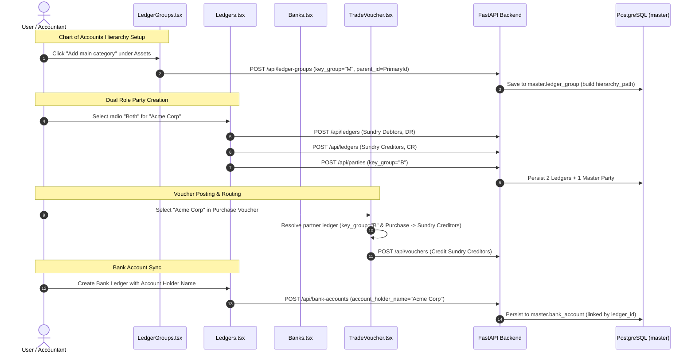

# Master Module Changes & Technical Changelog

> **Document Name:** `Master_changes_11_10_26.md`  
> **Repository:** Audit1 / ImmBiz Books  
> **Modules Covered:** Master Module (Ledgers, Ledger Groups, Bank & Cash, Company Context), Trade Vouchers, and Backend Services/Schemas/Models  

---

## Executive Summary

This document provides a comprehensive technical record of all architectural updates, database schema alignments, validation enhancements, and UI refinements completed across the 11 targeted files.

The key functional areas addressed are:
1. **Dynamic Ledger Categorization & Quick Types:** Replacing legacy checkboxes with toggleable radio options (**Bank**, **Cash**, **Customer**, **Vendor**, **Both**) with contextual dynamic forms.
2. **Dual-Role ("Both") Party Sync & Voucher Routing:** Dual ledger creation (*Sundry Debtors* + *Sundry Creditors*) linked to a unified party profile (`key_group = 'B'`), with dynamic ledger resolution in sales and purchase vouchers.
3. **Group-Scoped Name Uniqueness:** Scoping ledger duplicate checks by `ledger_group_id` so identical party names can exist under Debtors and Creditors.
4. **Main Category Creation:** Adding full creation and management support for **Main categories (`key_group = 'M'`)** in the Chart of Accounts.
5. **Bank Account Master Persistence:** Adding and syncing `account_holder_name` across UI, backend schemas, SQLAlchemy models, and the database.
6. **Company Financial Year Support:** Adding `financial_year_start` and `financial_year_end` fields to the active company context.

---

## File-by-File Breakdown

---

### 1. [frontend-react/src/pages/Ledgers.tsx](file:///c:/Users/Ranra/Siva_imm/Open_Code/Git/audit1/frontend-react/src/pages/Ledgers.tsx)

#### Key Changes:
* **Quick Ledger Type Radio Buttons:**
  * Replaced individual checkboxes with 5 mutually exclusive, toggleable radio buttons: `Bank`, `Cash`, `Customer`, `Vendor`, `Both`.
  * Clicking an active radio deselects it, reverting to `General`.
* **Permanent Standard Fields Header:**
  * **Ledger Name**, **Opening Balance**, **Dr / Cr**, and **As on Date** remain permanently visible at the top regardless of which type is selected.
* **Contextual Dynamic Fields:**
  * Renders specific form sections based on selected radio:
    * **Bank:** Bank name, Account holder name, Account number, IFSC code, Branch.
    * **Cash:** Cash description / narration.
    * **Customer / Vendor / Both:** GSTIN, GST type, PAN, Contact Person, Mobile, Email, Structured Billing & Shipping Addresses (with "Same as billing" toggle), Credit Limit, Payment Terms.
    * **General:** Default GST rate, HSN/SAC, Description, Department/Cost Center, Tags.
* **Dynamic Group Hierarchy:**
  * Displays **Primary $\rightarrow$ Main $\rightarrow$ Sub-category** dropdowns for Bank, Cash, Customer, Vendor, and General.
  * Hides the single hierarchy dropdown when **Both** is selected, replacing it with the **Dual Role Party banner**.
* **Dual-Ledger Creation for "Both":**
  * When saving a "Both" party, automatically creates two ledgers:
    1. Debtor ledger under `Sundry Debtors` (`DR`)
    2. Creditor ledger under `Sundry Creditors` (`CR`)
  * Syncs a unified profile to `/parties` with `key_group: "B"`.
* **Bank Sync with `account_holder_name`:**
  * Synchronizes Bank details to `/api/bank-accounts`, including `account_holder_name`. Updates existing bank record (`PUT`) or creates new (`POST`).
  * In `openEdit`, pre-fills `account_holder_name` from linked bank account.
* **Removed Multi-Select Checkboxes:**
  * Removed row checkboxes and the bulk action bar from the master table (documented separately in `LEDGER_BULK_ACTIONS_SPEC.md`).

---

### 2. [frontend-react/src/pages/LedgerGroups.tsx](file:///c:/Users/Ranra/Siva_imm/Open_Code/Git/audit1/frontend-react/src/pages/LedgerGroups.tsx)

#### Key Changes:
* **"Add main category" Button:**
  * Added on the **Main** tab (`tab === "M"`), mirroring the existing "Add sub-category" button on the Sub-categories tab.
* **Drawer Support for Main Category:**
  * Displays title **"New main category"** / **"Edit main category"**.
  * Shows **Primary category** dropdown populated with the 4 root Primary categories (*Assets, Liabilities, Income, Expenses*).
  * Requires user to select **Normal balance** (`DR` or `CR`, not auto-defaulted per requirement).
* **Save Payload & State:**
  * Form state tracks `key_group: "M" | "S"`.
  * Submits `key_group = "M"` with `parent_id` pointing to the selected Primary group.
  * Toast feedback: `"Main category created"` / `"Main category updated"`.

---

### 3. [frontend-react/src/pages/TradeVoucher.tsx](file:///c:/Users/Ranra/Siva_imm/Open_Code/Git/audit1/frontend-react/src/pages/TradeVoucher.tsx)

#### Key Changes:
* **Dual-Role Party Resolution in `buildDetails()`:**
  * Inspects `party.key_group`. If `party.key_group === "B"`:
    * **Sales Vouchers (`isSales`):** Uses the Debtor ledger (`Sundry Debtors`).
    * **Purchase Vouchers (`!isSales`):** Dynamically finds and uses the partner Creditor ledger (`Sundry Creditors` / `CR`) matching the party's name.
  * Prevents purchase vouchers from crediting Sundry Debtors and ensures payables are accurately booked.
* **Party Dropdown Options:**
  * `partyOptions` includes both role-specific parties (`partyGroup`) and dual-role parties (`key_group === "B"`).

---

### 4. [frontend-react/src/pages/Banks.tsx](file:///c:/Users/Ranra/Siva_imm/Open_Code/Git/audit1/frontend-react/src/pages/Banks.tsx)

#### Key Changes:
* **Account Holder Name Integration:**
  * Added `account_holder_name` to `Account` interface and `empty()` state.
  * Added `Account holder name` input field in the drawer for Bank accounts.
  * Pre-fills `account_holder_name` in `openEdit()`.
  * Sends `account_holder_name` in payload on create (`POST`) and update (`PUT`).

---

### 5. [frontend-react/src/auth/CompanyContext.tsx](file:///c:/Users/Ranra/Siva_imm/Open_Code/Git/audit1/frontend-react/src/auth/CompanyContext.tsx)

#### Key Changes:
* **Company Summary Type Extension:**
  * Added `financial_year_start?: string | null;`
  * Added `financial_year_end?: string | null;`
  * Allows pages (such as Ledgers and Vouchers) to access the active company's fiscal year boundaries to default opening balance and voucher dates.

---

### 6. [backend/app/services/ledger_service.py](file:///c:/Users/Ranra/Siva_imm/Open_Code/Git/audit1/backend/app/services/ledger_service.py)

#### Key Changes:
* **Group-Scoped Uniqueness Validation:**
  * Updated `LedgerService.validate()` to accept `ledger_group_id: Optional[UUID] = None`.
  * If `ledger_group_id` is supplied, duplicate name checks are filtered to `Ledger.ledger_group_id == ledger_group_id`.
  * Error message adjusted to: `"A ledger named '{dup.name}' already exists in this group"`.
* **Group-Scoped Duplicate Check in `create()`:**
  * In `LedgerService.create()`, scoped the duplicate check query by `ledger_group_id`.
  * Allows a company to have accounts with the same name under different groups (e.g. *Sundry Debtors* and *Sundry Creditors* for dual-role parties).

---

### 7. [backend/app/services/bank_account_service.py](file:///c:/Users/Ranra/Siva_imm/Open_Code/Git/audit1/backend/app/services/bank_account_service.py)

#### Key Changes:
* **Serialization in `_to_dict`:**
  * Added `"account_holder_name": b.account_holder_name` to the dictionary returned by `BankAccountService._to_dict()`.
* **Model Dump Persistence:**
  * `create()` and `update()` automatically unpack `account_holder_name` from `BankAccountCreate` / `BankAccountUpdate` and commit it to `master.bank_account`.

---

### 8. [backend/app/schemas/ledger.py](file:///c:/Users/Ranra/Siva_imm/Open_Code/Git/audit1/backend/app/schemas/ledger.py)

#### Key Changes:
* **`LedgerValidateRequest` Schema:**
  * Added `ledger_group_id: Optional[UUID] = None` to `LedgerValidateRequest` to pass the active group ID during debounced live validation.

---

### 9. [backend/app/schemas/bank_account.py](file:///c:/Users/Ranra/Siva_imm/Open_Code/Git/audit1/backend/app/schemas/bank_account.py)

#### Key Changes:
* **`BankAccountBase` Schema:**
  * Added `account_holder_name: Optional[str] = Field(None, max_length=100)`.
  * Inherited by `BankAccountCreate`, `BankAccountUpdate`, and `BankAccountResponse`.

---

### 10. [backend/app/models/bank_account.py](file:///c:/Users/Ranra/Siva_imm/Open_Code/Git/audit1/backend/app/models/bank_account.py)

#### Key Changes:
* **SQLAlchemy Model Column:**
  * Added `account_holder_name = Column(String(100))` to `class BankAccount(Base)`.
  * Matches database table column `master.bank_account.account_holder_name`.

---

### 11. [backend/app/routers/ledger.py](file:///c:/Users/Ranra/Siva_imm/Open_Code/Git/audit1/backend/app/routers/ledger.py)

#### Key Changes:
* **Validation Route Parameter Passing:**
  * In `POST /api/ledgers/validate`, passed `ledger_group_id=body.ledger_group_id` into `LedgerService.validate()`.

---

## System Integration Summary

---

## Verification & Status

* **TypeScript Compilation:** Passed with 0 errors (`tsc -b && vite build`).
* **HMR & Dev Server:** Tested running on port 4300.
* **Backend Status:** Running via Uvicorn on port 8000.
