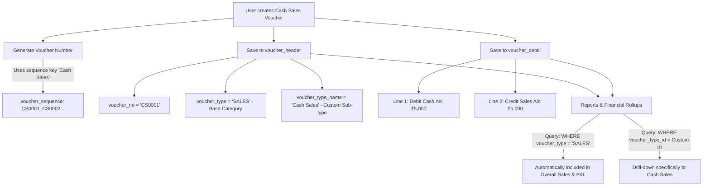

# Voucher Module Enhancements & Navigation Overhaul — Master Log (Session 11_10_16)

**Date:** 2026-10-14  
**Scope:** Comprehensive documentation of all voucher module action items, two-tier dropdowns, party auto-tally, due date auto-calculation, entitlement bug fixes, and dropdown keyboard navigation overhaul.

---

## 1. Master Action Items Roadmap & Status

| Action Item | Description | Files Modified | Status |
| :--- | :--- | :--- | :--- |
| **Item 1: Numbering Sequence Replication** | Auto-replicate new custom voucher types into `voucher_sequence` so prefix, width, and running number are configurable in Settings (`/app/settings`). Increased `voucher_type` column length from 20 to 100. | `backend/app/services/voucher_type_service.py`<br>`backend/app/models/voucher_sequence.py`<br>`backend/app/core/init_db.py` | **Completed & Verified** |
| **Item 2.a: Two-Tier Dropdowns** | Split single voucher type into two dependent dropdowns:<br>1. **Base Voucher Type:** Standard system categories (`JOURNAL`, `SALES`, `PURCHASE`, `RECEIPT`, `PAYMENT`, `CONTRA`, `DEBIT_NOTE`, `CREDIT_NOTE`).<br>2. **Voucher Type:** User-defined custom types (e.g., *Cash Sales* under *Sales*). Disabled if no custom type exists. | `frontend-react/src/pages/AccountingVouchers.tsx` | **Completed & Verified** |
| **Item 2.b: Remove DR/CR Restrictions** | Completely removed restrictions that forced only bank/cash on specific sides. Any active ledger can now be selected on both Debit and Credit sides. | `backend/app/services/voucher_header_service.py`<br>`frontend-react/src/pages/AccountingVouchers.tsx` | **Completed & Verified** |
| **Item 2.c: Searchable Ledger Combobox** | Transformed table row ledger account selectors into searchable input comboboxes with instant filtering, ledger group badges, and clear (<kbd>×</kbd>) button. | `frontend-react/src/pages/AccountingVouchers.tsx` | **Completed & Verified** |
| **Item 2.d: Line 1 Party/Bank Reservation & Auto-Tally** | When Party or Bank is selected in the header:<br>• Line 1 is automatically reserved and locked to that party/bank.<br>• Line 1 amount auto-tallies to balance all other voucher lines.<br>• Line 1 DR/CR side remains freely toggleable. | `frontend-react/src/pages/AccountingVouchers.tsx` | **Completed & Verified** |
| **Item 2.e: Due Date Calculation from Payment Terms** | Automatically calculates `due_date = voucher_date + terms` (e.g., Net 30, Net 15) when a Customer or Vendor with configured terms is chosen. | `frontend-react/src/pages/AccountingVouchers.tsx` | **Completed & Verified** |
| **Item 3: Voucher Number Preservation** | When modifying existing vouchers, the original voucher number (`voucher_no`) and sequence remain strictly preserved. | `backend/app/services/voucher_header_service.py` | **Completed & Verified** |
| **Item 4: Fix `UserMaster` & `HTTPException`** | Fixed unresolved `UserMaster` query and `HTTPException` in `post_voucher()` entitlement check that was causing silent runtime failures. | `backend/app/services/voucher_header_service.py` | **Completed & Verified** |
| **Item 5: Dropdown Highlight & Contrast Overhaul** | Replaced pale `bg-accent/50` highlight with **bold white text + deep teal background (`bg-primary font-bold`)** on <kbd>↓</kbd> / <kbd>↑</kbd> arrow navigation. Upgraded all 4 dropdowns (Base Type, Voucher Type, Party, and Ledger Account) to the unified searchable combobox. | `frontend-react/src/pages/AccountingVouchers.tsx`<br>`frontend-react/src/components/GlobalSearch.tsx` | **Completed & Verified** |

---

## 2. In-Depth Implementation Breakdown by Action Item

### Item 1: Numbering Sequence Auto-Replication
* **What was changed:**
  * When a new custom voucher type is created in [voucher_type_service.py](file:///c:/Users/Ranra/Siva_imm/Open_Code/Git/audit1/backend/app/services/voucher_type_service.py), the service automatically creates a corresponding row in `master.voucher_sequence` with default prefix (first 2-3 letters) and width `4`.
  * Allows users to configure custom prefixes (e.g. `CS` for Cash Sales &rarr; `CS0001`) from System Settings.
  * In [voucher_sequence.py](file:///c:/Users/Ranra/Siva_imm/Open_Code/Git/audit1/backend/app/models/voucher_sequence.py) and [init_db.py](file:///c:/Users/Ranra/Siva_imm/Open_Code/Git/audit1/backend/app/core/init_db.py), expanded `voucher_type` column length to `VARCHAR(100)` to accommodate descriptive custom names.

---

### Item 2.a: Two-Tier Dropdowns (Base Type & Custom Type)
* **What was changed in [AccountingVouchers.tsx](file:///c:/Users/Ranra/Siva_imm/Open_Code/Git/audit1/frontend-react/src/pages/AccountingVouchers.tsx):**
  * Split the single voucher selector into two dependent dropdowns:
    * **Dropdown 1 (Base Voucher Type):** Lists standard system categories (`baseTypes = voucherTypes.filter(vt => vt.is_system === "Y")`).
    * **Dropdown 2 (Voucher Type):** Dynamically filters custom types (`customTypesForBase = voucherTypes.filter(vt => vt.is_system === "N" && vt.base_voucher_type === selectedBase)`).
    * If no custom voucher type exists for the selected base category, Dropdown 2 is disabled and displays *"No custom voucher"*.

---

### Item 2.b: Complete Removal of DR/CR Restrictions
* **What was changed:**
  * Previously, `get_account_ledger_options` in [voucher_header_service.py](file:///c:/Users/Ranra/Siva_imm/Open_Code/Git/audit1/backend/app/services/voucher_header_service.py) only allowed Bank/Cash accounts on Debit for Receipt and Credit for Payment.
  * Replaced filtering logic so that **any active ledger account** is returned under both `options["DEBIT"]` and `options["CREDIT"]`.

---

### Item 2.c: Searchable Combobox for Ledger Accounts
* **What was changed:**
  * Replaced the standard select element in the table rows with a responsive text input combobox.
  * Users can type to filter ledgers by name or ledger group.
  * Added clear button (<kbd>×</kbd>) to easily remove selected accounts.

---

### Item 2.d: Line 1 Reservation & Auto-Tally for Party / Bank
* **What was changed in [AccountingVouchers.tsx](file:///c:/Users/Ranra/Siva_imm/Open_Code/Git/audit1/frontend-react/src/pages/AccountingVouchers.tsx):**
  * Added `autoBalancePartyLine()` helper:
    * When a Party (Customer/Vendor) or Bank/Cash account is selected in the header, Line 1 is automatically locked to that account with read-only ledger name.
    * Line 1 amount is automatically computed:
      $$\text{Line 1 Amount} = \sum(\text{Opposite Side Lines}) - \sum(\text{Same Side Lines 2+})$$
    * Line 1's DR/CR side remains fully toggleable by the user, and opposite side defaults accordingly.
    * Primary ledger identifiers are excluded from lines 2+ to prevent accidental duplicate entries.

---

### Item 2.e: Due Date Calculation from Payment Terms
* **What was changed in [AccountingVouchers.tsx](file:///c:/Users/Ranra/Siva_imm/Open_Code/Git/audit1/frontend-react/src/pages/AccountingVouchers.tsx):**
  * Added `getPartyPaymentTerms()` to inspect party and ledger `payment_terms` (e.g. `30`, `"Net 30"`, `15`).
  * On selecting a party or changing voucher date, `computeDueDate(voucherDate, terms)` automatically computes and populates `form.due_date`.

---

### Item 4: Fix `UserMaster` & `HTTPException` in Entitlement Checks
* **File:** [voucher_header_service.py](file:///c:/Users/Ranra/Siva_imm/Open_Code/Git/audit1/backend/app/services/voucher_header_service.py)
* **What was removed:**
  ```python
  # Missing imports at top of voucher_header_service.py
  from app.models.voucher_type import VoucherType
  from app.schemas.voucher_header import VoucherHeaderCreate, VoucherHeaderUpdate
  ```
* **What was added:**
  ```python
  from fastapi import HTTPException
  from app.models.voucher_type import VoucherType
  from app.models.user_master import UserMaster
  from app.schemas.voucher_header import VoucherHeaderCreate, VoucherHeaderUpdate
  ```
* **Why:** Resolved `NameError: name 'UserMaster' is not defined` on line 670 and prevented `NameError: name 'HTTPException' is not defined` when posting limits are exceeded.

---

### Item 5: Dropdown Highlight & Contrast Overhaul (Option 2)
* **File:** [AccountingVouchers.tsx](file:///c:/Users/Ranra/Siva_imm/Open_Code/Git/audit1/frontend-react/src/pages/AccountingVouchers.tsx)
* **What was removed:**
  ```tsx
  // REMOVED: Pale bg-accent/50 highlight (hard to see on white popover):
  className={cn(
    "flex items-center justify-between px-3 py-1.5 text-xs cursor-pointer transition-colors",
    isSelected && "bg-accent/80 font-semibold text-accent-foreground",
    isHighlighted && !isSelected && "bg-accent/50 text-accent-foreground",
    !isSelected && !isHighlighted && "hover:bg-accent/40"
  )}

  // REMOVED: Native <Select> elements for Base Voucher, Custom Voucher, and Party
  ```
* **What was added:**
  * Created `StyledSearchableSelect` unified combobox:
    ```tsx
    // NEW: High contrast bold teal highlight with left border:
    className={cn(
      "flex items-center justify-between px-3 py-2 text-xs cursor-pointer transition-colors border-l-4",
      isHighlighted
        ? "bg-primary text-primary-foreground font-bold border-l-primary shadow-sm"
        : isSelected
        ? "bg-[var(--teal-soft)] text-primary font-semibold border-l-primary"
        : "border-l-transparent text-foreground hover:bg-muted/70"
    )}
    ```
  * Upgraded **Base Voucher Type**, **Voucher Type (Custom)**, **Party / Bank Account**, and **Ledger Account** to use `StyledSearchableSelect`.
  * Added keyboard navigation (<kbd>↓</kbd> / <kbd>↑</kbd>, <kbd>Enter</kbd>, <kbd>Tab</kbd>, <kbd>Esc</kbd>), auto-scrolling, clear (<kbd>×</kbd>) buttons, and rotating `<ChevronDown />` icons.
  * Updated [GlobalSearch.tsx](file:///c:/Users/Ranra/Siva_imm/Open_Code/Git/audit1/frontend-react/src/components/GlobalSearch.tsx) with matching high-contrast active item styling.

---

## 3. Database Architecture & Flow (Custom Voucher Rollup)

### When you create a Custom Voucher (e.g., Sales &rarr; Cash Sales):


1. **Independent Numbering Series:**
   * Custom types have their own sequence in `voucher_sequence` (`CS0001`, `CS0002`...).
   * Standard Sales retains its own series (`SV0001`, `SV0002`...).
2. **Base Category Aggregation:**
   * In `voucher_header`, `voucher_type` is stored as `"SALES"`.
   * All reports (P&L, Daybook, Revenue charts, AR ageing) aggregate by `voucher_type == "SALES"`.
   * Every transaction under "Cash Sales" is automatically included in the overall Sales revenue total.

---

## 4. Revert / Retrieval Guide

If you ever need to retrieve or revert any specific change:

### To Revert Item 4 (Backend Entitlement Imports):
In [voucher_header_service.py](file:///c:/Users/Ranra/Siva_imm/Open_Code/Git/audit1/backend/app/services/voucher_header_service.py#L1-L15), remove:
```python
from fastapi import HTTPException
from app.models.user_master import UserMaster
```

### To Revert Item 5 (Frontend Dropdown Overhaul):
In [AccountingVouchers.tsx](file:///c:/Users/Ranra/Siva_imm/Open_Code/Git/audit1/frontend-react/src/pages/AccountingVouchers.tsx):
1. Replace `<StyledSearchableSelect>` for Base Voucher, Custom Voucher, and Party with standard `<Select>` components.
2. In `SearchableLedgerSelect`, restore `bg-accent/50` styling if pale highlight is desired.

### To Revert Item 2.d (Line 1 Auto-Tally):
In [AccountingVouchers.tsx](file:///c:/Users/Ranra/Siva_imm/Open_Code/Git/audit1/frontend-react/src/pages/AccountingVouchers.tsx), remove calls to `autoBalancePartyLine()` from `selectParty()`, `selectBaseVoucherType()`, and `updateLine()`.

---

## 5. Verification Checklist

- [x] **1. Two-Tier Dropdowns:** Base Voucher Type loads system types; Custom Voucher Type filters matching user-created types.
- [x] **2. DR/CR Freedom:** Any active ledger account can be selected on either Debit or Credit.
- [x] **3. Searchable Ledger Combobox:** Input search in table rows with group name badges.
- [x] **4. Line 1 Party Auto-Tally:** Auto-balances Line 1 against all other lines when party/bank is chosen.
- [x] **5. Due Date Calculation:** Auto-computes due date from party payment terms.
- [x] **6. Entitlement Fix:** `UserMaster` and `HTTPException` resolved cleanly in `post_voucher()`.
- [x] **7. Keyboard Navigation Highlight:** High-contrast `bg-primary font-bold` active highlight across all dropdowns.
- [x] **8. TypeScript Compile:** Verified zero type errors (`npx tsc --noEmit` code 0).
